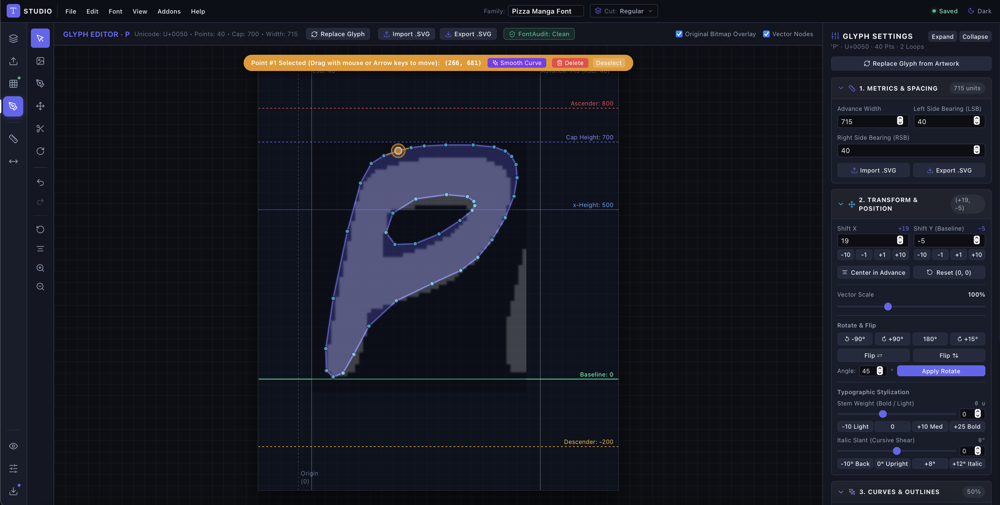
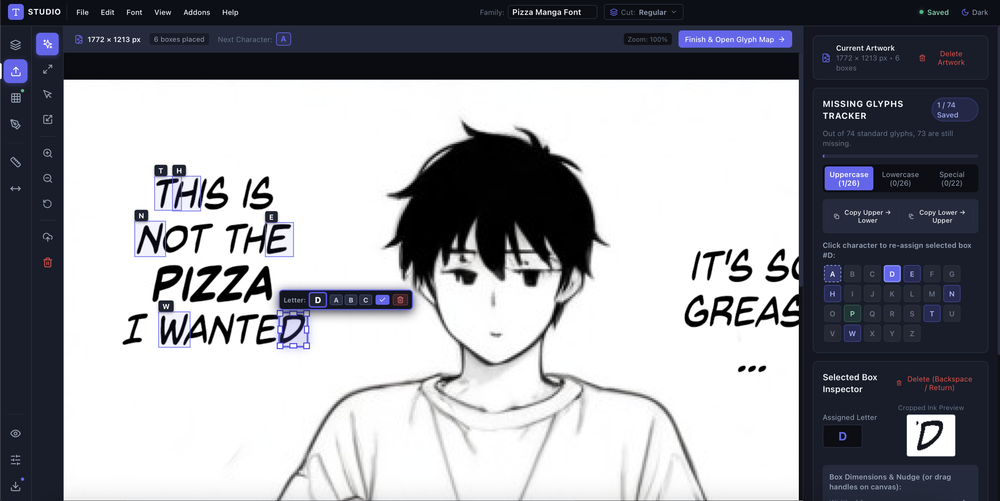
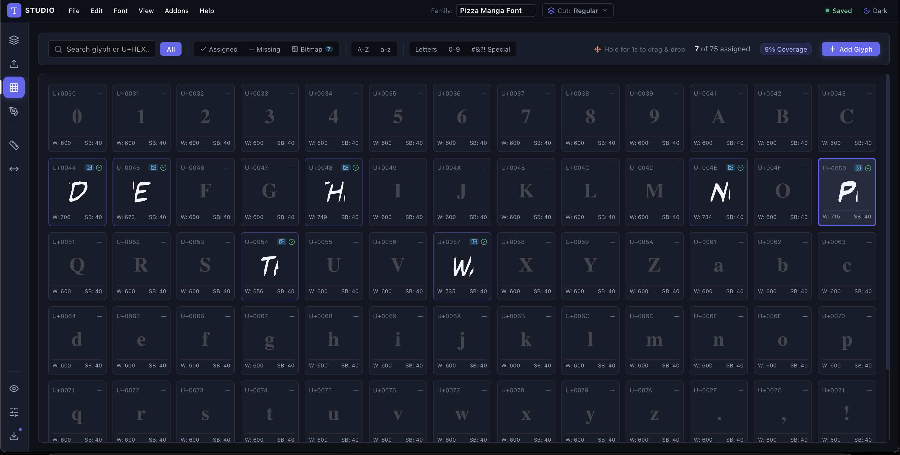
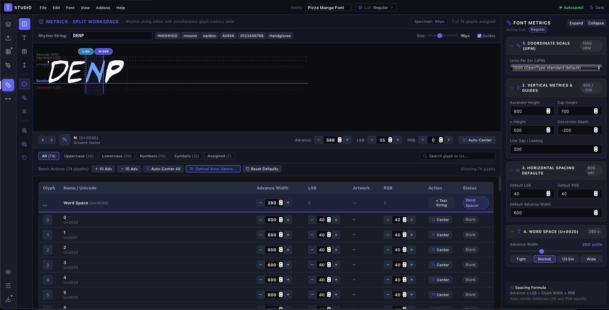

# Local Font Studio

> **Offline, private, in-browser typography design studio and OpenType font compiler.**  
> Crafted for independent comic creators, letterers, and typeface designers.


<p align="center">
  
</p>

---

## Overview

**Local Font Studio** is a standalone, browser-native type design workspace that lets you turn scanned handwriting, comic lettering, or custom vectors into installable binary OpenType fonts (`.otf`) and SVG archives.

Everything runs entirely on your local machine in client-side TypeScript. **No accounts, no cloud backend, no telemetry, and no subscription.**

---

## Key Features

- **Artwork Scan Importer**: Drag-and-drop alphabet sheets or ink scans, auto-detect glyph bounding boxes with Smart Snap, or draw custom boxes.
- **Vector Glyph Editor**: Interactive canvas with point-by-point contour editing, Laplacian curve smoothing, stem weight dilation/erosion, and italic slant transformations.
- **FontAudit Pre-Flight Checker**: Mathematical outline analyzer that identifies inverted winding direction, zero-length micro-segments, and collinear redundant points with 1-click auto-repair.
- **Metrics & Spacing Studio**: Calibrate sidebearings (LSB/RSB) and word space width (`U+0020`) across 4 interactive modes (Split Workspace, Rhythm Canvas, Glyph Table, and Vertical Metrics) with an Optical Auto-Spacing engine.
- **GPOS Kerning Studio**: Real-time vector pair kerning canvas with contextual sentence specimen waterfall and common pair presets (`AV`, `To`, `WA`, etc.).
- **Extensions & Addons System**: Modular plugin architecture featuring the *Comic Lettering & SFX Studio* (dialogue balloon simulator, Crossbar-I pronoun rules, and vector sound effects), alongside a custom manifest JSON importer.
- **Binary Font Exporter**: Compiles production-ready OpenType CFF (`.otf`) binary fonts and exports SVG contour archives (`.zip`) directly in the browser using `opentype.js`.

---

## Studio Tour

| Artwork Importer & Smart Slicer | Glyph Roster & Project Map |
| :---: | :---: |
|  |  |
| *Auto-detects ink boundaries with click-to-reassign letter badges* | *High-density Unicode glyph map with coverage tracker* |

| Vector Outline & Bézier Editor | Metrics & GPOS Kerning Studio |
| :---: | :---: |
|  |  |
| *Point-by-point path editing, stem dilation & FontAudit pre-flight* | *Interactive sentence waterfall & optical auto-spacing* |

---

## Getting Started

### Prerequisites

- **Node.js** `>= 18.0.0` (Recommended: Node 20 LTS or Node 22+)
- **npm** `>= 9.0.0`

### 1-Click Launch (macOS / Linux)

Clone the repository and run the startup script:

```bash
git clone https://github.com/wieserd/local-font-studio.git
cd local-font-studio
./start-local.sh
```

The script automatically installs dependencies on first launch and opens Local Font Studio at `http://127.0.0.1:5173`.

---

### Standard Manual Installation

```bash
# 1. Clone repository
git clone https://github.com/wieserd/local-font-studio.git
cd local-font-studio

# 2. Install dependencies
npm install

# 3. Start development server
npm run dev
```

Visit [http://localhost:5173](http://localhost:5173) in your web browser.

---

## NPM Scripts

You can run all commands directly from the project root:

| Command | Description |
| :--- | :--- |
| `npm run dev` *(or `npm start`)* | Launches the Vite local development server on `http://localhost:5173`. |
| `npm run build` | Runs TypeScript type checking and produces an optimized production bundle in `dist/`. |
| `npm test` | Runs the automated 31-case test suite (`contourUtils`, `typesetter`, `fontAudit`, `fontExporter`, `addons`). |
| `npm run typecheck` | Validates TypeScript types across the entire project without emitting code. |

---

## Project Structure

```
local-font-studio/
├── app/
│   └── frontend/
│       ├── package.json         # Frontend configuration and dependencies
│       ├── vite.config.ts       # Vite bundling and build settings
│       ├── tsconfig.json        # TypeScript compiler configuration
│       └── src/
│           ├── addons/          # Extensions system & Comic Lettering flagship addon
│           ├── components/      # Global UI components (Sidebar, Menus, Modals)
│           ├── context/         # React contexts (FontContext, AppSettingsContext)
│           ├── types/           # Core typography and project type definitions
│           ├── utils/           # Font compilation, typesetter, FontAudit, tracer
│           └── views/           # Studio views (Import, Glyphs, Editor, Metrics, Kerning, Preview)
├── docs/
│   ├── images_/                 # Studio screenshots & interface tour assets
│   └── HANDBOOK.md              # In-depth typography manual and studio handbook
├── scripts/
│   └── backup.sh                # Portable rolling snapshot backup utility
├── LICENSE.md                   # Non-commercial software license & creator output exemption
├── package.json                 # Root monorepo orchestration scripts
├── README.md                    # Project documentation
├── start-local.sh               # Portable 1-click startup script
└── .gitignore                   # Git ignore rules for node_modules, dist, and local caches
```

---

## Software Licensing & The S.O.U.L. License

Local Font Studio is distributed under the **S.O.U.L. License (Version 1.0)** — *Share-Alike • Output-Unrestricted • Uncommercial • Leave-Me-Alone* (see [`LICENSE.md`](LICENSE.md)).

> *"I am not here to make software so big companies can profit from it. This tool is built to empower small creators, letterers, and indie publishers with every possibility to create, sell, and own their fonts. Do no harm, share your improvements, and please leave me alone—I am not responsible for what you are doing with this.  
> **In short: Add some S.O.U.L.**"* — **wieserd**

### The S.O.U.L. Breakdown:
- **[S] Share-Alike**: Reciprocal copyleft. Forks and adaptations must remain under the exact same S.O.U.L. terms and credit the initial creator (**wieserd**).
- **[O] Output-Unrestricted (§ 5)**: **100% Creator Ownership.** Every font, glyph, vector contour, and `.otf` file you design is exclusively yours. Sell or license your typefaces with zero royalties or restrictions.
- **[U] Uncommercial**: Big corporations cannot commercialize, sell, or host this software as a paid SaaS platform.
- **[L] Leave-Me-Alone (§ 8–10)**: The software is provided "AS IS" with zero warranty and zero liability ($0.00 aggregate cap). The author disclaims any affiliation with or liability for third-party forks.

---

## Contributing & Bug Reports

Contributions, feature requests, and bug reports are welcome!  
Feel free to open an issue or pull request on [GitHub](https://github.com/wieserd/local-font-studio).
